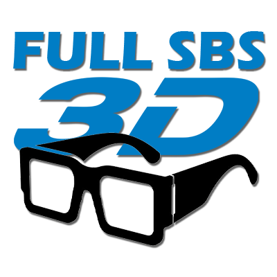
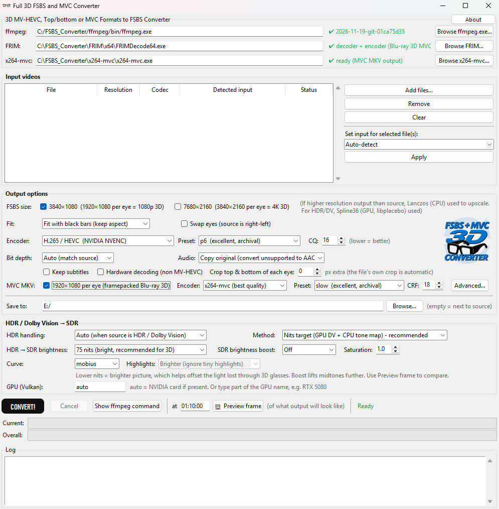

<p align="center"></p>

# 👓 Full 3D FSBS and MVC Converter

**3D MV-HEVC, Top/bottom or MVC Formats to FSBS or MVC**

A Windows app for converting 3D videos or movies into **Full Side-by-Side (FSBS)** `.mkv` files that 3D TVs, 3D projectors, VR headsets and media players can play, and into **framepacked Blu-ray 3D (MVC) `.mkv`** files for players that play MVC 3D:

- **3840×1080 FSBS**: 1920×1080 per eye = **1080p 3D**, for 1080p 3D TVs and projectors
- **7680×2160 FSBS**: 3840×2160 per eye = **4K 3D**, keeps full 4K per eye from UHD sources
- **MVC MKV**: 1920×1080 per eye, **framepacked Blu-ray 3D** (H.264 MVC), the same layout as MakeMKV 3D rips, for players that decode MVC (e.g. Zidoo, Dune, Kodi on some devices like PCs or Raspberry Pi5 with LibreELEC builds or Amlogic media players with CoreELEC or Vero V)

The app is a graphical front end for **FFmpeg**, plus **FRIM** for Blu-ray 3D and **x264-mvc** or **FRIM Encoder** for MVC output. It handles **HDR** and **Dolby Vision → SDR** tone mapping with adjustable brightness, previews a frame before you convert, and keeps your audio, subtitles and chapters.

<p align="center"></p>

---

## Features

- **Input formats**
  - **MV-HEVC 3D**: Apple spatial video, Apple Vision Pro, streaming 3D movies, including **Dolby Vision Profile 20**
  - **H.264 MVC**: Blu-ray 3D, e.g. MakeMKV 3D rips (decoded with FRIM)
  - **Half / Full Side-by-Side** and **Half / Full Top-Bottom (Over-Under)**
  - The input layout is auto-detected, and you can override it per file
- **Output**
  - FSBS `.mkv` tagged as 3D (`stereo_mode = left_right`), so players switch to 3D automatically
  - Optional **MVC MKV** from **any** input, encoded with **x264-mvc** or **FRIM Encoder**, with both eyes in one track (`stereo_mode = block_lr`, "both eyes laced in one block, left eye first"). MediaInfo shows *Format profile: Stereo High* and *Count of views: 2*.
- **HDR / Dolby Vision → SDR**
  - Dolby Vision colour data is applied on the GPU, separately for each eye
  - Brightness is set as a **nits target**, where lower = brighter. 75 nits is recommended for 3D glasses.
  - Optional brightness boost and saturation
- **Preview frame**: renders one frame of the final output at any time position, so you can check brightness and colour before a long encode
- **Encoders**
  - NVIDIA NVENC (HEVC / AV1)
  - x265 (CPU)
  - Intel Quick Sync and AMD AMF (HEVC)
- **Audio and subtitles**: original audio is kept (e.g. Dolby Atmos / TrueHD / DTS). Subtitles and chapters are kept too.
- **Batch conversion**: drag and drop files or folders onto the window

---

## Requirements

| What | Needed for | Where to get it |
|---|---|---|
| **Windows 10 or 11** (64-bit) | everything | |
| **Python 3.10 or newer** | running the app | <https://www.python.org/downloads/> |
| **FFmpeg "full" build, version 7.1 or newer** | everything | <https://www.gyan.dev/ffmpeg/builds/> |
| **FRIM** (free MVC decoder and encoder) | **only** Blu-ray 3D / MVC input, or MVC output with FRIM Encoder | <https://www.videohelp.com/software/FRIM> |
| **x264-mvc** (MVC encoder) | **only** MVC MKV output with x264-mvc | `x264-mvc-win64.zip` on this repo's **Releases** page (built from <https://github.com/blenheimears/x264-mvc>) |
| A GPU with Vulkan support (any recent NVIDIA, AMD or Intel GPU with current drivers) | HDR / Dolby Vision → SDR | your GPU vendor's driver |

> FFmpeg, FRIM and x264-mvc are separate projects with their own licences, so they are **not included** in the app download. You download and unzip them yourself (below).

---

## Installation

### 1. Download this app
Download the latest `Full-SBS-3D-Converter-v1.1.zip` from the **Releases** page and unzip it to a simple location, for example:

```
C:\Full-SBS-3D-Converter\
```
Avoid `C:\Program Files`, because the app saves files next to itself.

### 2. Install Python
1. Go to <https://www.python.org/downloads/> and choose the **standalone installer** for the latest Python 3 version, under "Or get the standalone installer for Python 3.x.x".
2. On the first installer screen, **tick "Add python.exe to PATH"**, then click **Install Now**. The default install includes *tcl/tk*, which the app's window needs.

### 3. Download and unzip FFmpeg
1. Go to <https://www.gyan.dev/ffmpeg/builds/> and download **`ffmpeg-release-full.7z`** (or `ffmpeg-git-full.7z`).
   Use the **full** build: the "essentials" build lacks the libraries needed for HDR / Dolby Vision tone mapping.
2. Unzip it into the app's **`ffmpeg`** folder, using **7-Zip** (<https://www.7-zip.org>) or Windows 11's *right-click → Extract All*.

### 4. (Only for Blu-ray 3D MVC input, or MVC output with FRIM Encoder) Download and unzip FRIM
1. Go to <https://www.videohelp.com/software/FRIM> and download the **x64** version of FRIM.
2. Unzip it into the app's **`FRIM`** folder. It contains both `FRIMDecode64.exe` (MVC input) and `FRIMEncode64.exe` (MVC output).

### 5. (Only for MVC MKV output with x264-mvc) Download and unzip x264-mvc
1. Download **`x264-mvc-win64.zip`** from this repo's **Releases** page (v1.1 or newer).
2. Unzip it into the app folder, so you have `x264-mvc\x264-mvc.exe`.
   If Windows SmartScreen warns about it, click **More info → Run anyway** (it is an unsigned open-source build).

The same release also has **`x264-mvc-source-769f98e.zip`**, the exact x264-mvc source code this build was made from (provided as required by its GPL licence). You don't need it to use the app.

<details>
<summary>Prefer to build x264-mvc yourself? (MSYS2)</summary>

1. Install MSYS2 (<https://www.msys2.org>), open the **MSYS2 MINGW64** terminal and run:
   ```
   pacman -S --needed git make nasm mingw-w64-x86_64-gcc
   git clone https://github.com/blenheimears/x264-mvc.git
   cd x264-mvc
   chmod +x configure config.guess config.sub version.sh
   ./configure --enable-static
   make -j8
   ```
2. Copy `x264.exe` into the app's **`x264-mvc`** folder and rename it **`x264-mvc.exe`**.
</details>

Don't need x264-mvc? Choose **FRIM Encoder** for MVC output instead.

### Resulting folder layout
```
C:\Full-SBS-3D-Converter\
├── fsbs_converter.py
├── Start Full SBS 3D Converter.bat
├── Build EXE (optional).bat
├── glasses.ico
├── logo.png
├── README.md
├── ffmpeg\
│   └── ffmpeg-...-full_build\        ← (or directly: ffmpeg\bin\)
│       └── bin\
│           ├── ffmpeg.exe
│           └── ffprobe.exe
├── FRIM\                             ← only for Blu-ray 3D MVC input, or MVC output with FRIM Encoder
│   └── x64\
│       ├── FRIMDecode64.exe
│       └── FRIMEncode64.exe  (+ their DLLs)
└── x264-mvc\                         ← only for MVC MKV output with x264-mvc
    └── x264-mvc.exe
```
The app finds `ffmpeg.exe`, `FRIMDecode64.exe`/`FRIMEncode64.exe` and `x264-mvc.exe` automatically in these folders; ffmpeg is also found in your Downloads folder or `C:\ffmpeg`. If they are somewhere else, use the **Browse ffmpeg.exe…**, **Browse FRIM…** and **Browse x264-mvc…** buttons once; the app remembers them.

### 6. Start the app
Double-click **`Start Full SBS 3D Converter.bat`**.
The top of the window has one row each for **ffmpeg**, **FRIM** and **x264-mvc**, with a green **✔** next to each tool that was found. FRIM and x264-mvc are optional.

*Optional:* run **`Build EXE (optional).bat`** to create a standalone `Full 3D FSBS and MVC Converter.exe` with the 👓 icon. Keep the `ffmpeg`, `FRIM` and `x264-mvc` folders next to it.

---

## How to use

1. **Add videos**: click **Add files…**, or drag files or a folder from File Explorer onto the window.
   Each file shows its resolution, codec (e.g. `hevc DV20`) and the **detected input** layout.
   If the detection is wrong, select the file, choose the correct layout under **Set input for selected file(s)** and click **Apply**.
2. **Choose the output(s)** under **Output options**:
   - **3840×1080**: best for 1080p 3D TVs and projectors, and for 1080p sources such as Blu-ray 3D. Much smaller files.
   - **7680×2160**: for true 4K-per-eye sources, e.g. 3D MV-HEVC streaming movies.
   - **MVC MKV**: framepacked Blu-ray 3D for MVC-capable players (see *MVC MKV output* below).
   - You can tick any combination; each ticked output is a separate file.
3. **Choose the encoder**: with an NVIDIA GPU, use **H.265 / HEVC (NVIDIA NVENC)** with preset **p6 (excellent, archival)**. It is many times faster than the CPU encoders.
   **CQ/CRF**: lower = better quality and larger file. **19–21** is a good range; 16 is very high quality.
4. **HDR / Dolby Vision sources**: leave **HDR handling = Auto** and **Method = Nits target**. Then pick a brightness:
   - **75 nits**: bright, recommended for 3D glasses
   - **50 nits**: brighter still
   - **100 nits**: standard
   - **Curve**: *mobius* keeps the most brightness and is the default.
5. **Preview**: type a time (e.g. `01:10:00`) and click **Preview frame**. You will see the left and right eye exactly as the output will look. Check a bright and a dark scene, then adjust brightness or saturation if needed.
6. Click **CONVERT!**. The progress bars show speed and ETA. Output is saved next to the source, or in the **Save to** folder, as `<name>_FSBS_3840x1080.mkv` / `<name>_FSBS_7680x2160.mkv` / `<name>_MVC_1920x1080.mkv`.

### Settings reference

| Setting | What it does |
|---|---|
| **Fit** | *Fit with black bars* keeps the original shape (recommended). *Stretch* fills the frame and distorts it. *Crop* fills the frame and trims the edges. |
| **Swap eyes** | For right-eye-first sources, or if the 3D depth looks inverted. |
| **Bit depth** | *Auto* = 8-bit SDR (most compatible). 10-bit reduces banding if your player supports it. |
| **Audio** | *Copy original* keeps the original audio tracks. Anything MKV can't hold is converted to AAC. |
| **Crop top & bottom of each eye** | Extra trimming per eye. Any crop stored in the file itself (e.g. a 3840×2076 clean aperture) is applied automatically, so leave this at 0. |
| **Upscaling** | When the output is larger than the source: Lanczos (CPU), or Spline36 (GPU, libplacebo) for HDR/DV. |
| **GPU (Vulkan)** | *auto* picks the NVIDIA card if present (important on PCs with integrated graphics). You can also type part of the GPU name. |
| **Show ffmpeg command** | Shows the exact command that will run. |

### MVC MKV output (framepacked Blu-ray 3D)
Tick **MVC MKV → 1920×1080 per eye (framepacked Blu-ray 3D)** to make an MVC file from **any** input. It can be made alongside the FSBS outputs, or on its own with both FSBS sizes unticked.
- **Encoder**
  - **x264-mvc (best quality)**: uses **Preset** and **CRF**; 18 is a good default.
  - **FRIM Encoder (Intel)**: comes with FRIM. Uses a **Bitrate** in kbps; 28000 is a good default, and Blu-ray level 4.1 allows a maximum of 40000.
- The output is 1920×1080 per eye, SDR (HDR and Dolby Vision are tone-mapped with your HDR settings), with the source's audio, subtitles and chapters.
- **Check it:** MediaInfo should show *Format profile: Stereo High@L4.1 / High@L4.1*, *Count of views: 2* and *MultiView_Layout: Both Eyes laced in one block (left eye first)*.
- **Players:** MVC MKV plays in 3D only on players that decode MVC. Elsewhere it plays as 2D, left eye only. Use FSBS for everything else.
- **Advanced…** (in the MVC MKV row) lets you edit the x264-mvc and FRIM Encoder command lines. B-frames must stay **off** (`--bframes 0` / `-gop 24 1`): raw MVC streams carry no timestamps.

### Blu-ray 3D (MVC) input notes
- When ripping with **MakeMKV**, tick the **"Mpeg4 MVC"** track under the video track. It is **off by default**, and without it the MKV only contains the left eye.
  Tip: in MakeMKV *Preferences → Advanced → Default selection rule*, add `+sel:mvcvideo` so it is always selected.
- Conversion copies the 3D video stream to a **temporary file next to the output** (30–45 GB for a typical disc; deleted afterwards). FRIM then decodes both eyes, and FFmpeg encodes them with the audio and subtitles from the original MKV.
- If your FRIM version needs different options, edit the **FRIM decoder arguments** under **Advanced…**. **Reset** restores the default: `-i:mvc {in} -sw -sbs -o {out}`.

### Temporary files

| What | Where | Cleaned up |
|---|---|---|
| MVC temp files `<name>….mvc_temp.h264`, `.mvc_source_temp.h264`, `.mvc_encoded_temp.h264`, `.mvc_video_temp.mkv` (up to 30–45 GB each) | output folder | Automatically after success, failure or cancel. They're only left behind if the app or PC crashes mid-conversion; then delete them by hand. |
| MVC preview clips | `%TEMP%\fsbs_mvc_…` | Right after the preview is shown |
| Preview images `fsbs_preview_….png` | `%TEMP%` | When the app is closed |
| Partial output of a cancelled or failed conversion | output folder | Automatically |
| Settings `.fsbs_converter.json` | `C:\Users\<you>\` | Kept, so your settings are remembered |

FSBS conversions from MV-HEVC, SBS and Top-Bottom use no temp files: FFmpeg writes straight to the output file.

---

## Troubleshooting

| Problem | Fix |
|---|---|
| "Python was not found" | Reinstall Python and tick **Add python.exe to PATH**. |
| FFmpeg line is red / not found | Unzip the FFmpeg **full** build into the `ffmpeg` folder, or click **Browse ffmpeg.exe…** and pick `bin\ffmpeg.exe`. |
| Vulkan / libplacebo error in preview | Update your GPU driver. On PCs with two GPUs, type part of your GPU name (e.g. `RTX 5080`) in **GPU (Vulkan)**. |
| Dolby Vision colours look green or purple | Use **Method = Nits target** or **Adaptive** (both apply the Dolby Vision data), not *CPU only*. |
| Picture too dark | Choose a lower nits value (75 → 50) or set **SDR brightness boost**. |
| MVC: both eyes look identical | The MKV was ripped without the **Mpeg4 MVC** track. Re-rip with it ticked. |
| MVC: "FRIM not set" | Unzip FRIM into the `FRIM` folder, or click **Browse FRIM…** and pick `FRIMDecode64.exe`. |
| MVC output: "x264-mvc not found" | Unzip `x264-mvc-win64.zip` into the app folder (see installation step 5), click **Browse x264-mvc…**, or choose **FRIM Encoder**. |
| MVC output: "FRIM Encoder not found" | `FRIMEncode64.exe` must be next to `FRIMDecode64.exe`. Unzip the full FRIM package into the `FRIM` folder. |
| MVC output plays in 2D | Your player doesn't decode MVC. Use the FSBS output for that player. |
| Anything else | Copy the last lines from the **Log** box when reporting an issue. |

---

## Command line (optional)
The same engine can be used without the window:
```
python fsbs_converter.py --cli "movie.mp4" --size 7680 --encoder hevc_nvenc --preset p6 --quality 20 --nits 75
python fsbs_converter.py --cli "movie.mp4" --size mvc --mvc-encoder x264mvc --mvc-crf 18
python fsbs_converter.py --cli "movie.mp4" --preview 01:10:00
python fsbs_converter.py --cli --help
```

---

## Credits

**By ht2tweak and Claude AI**, version 1.1.

This app uses, but does not include:
- **FFmpeg**: <https://ffmpeg.org> (LGPL/GPL); Windows builds by Gyan Doshi, <https://www.gyan.dev/ffmpeg/builds/>
- **libplacebo**, used through FFmpeg for GPU tone mapping and Dolby Vision processing
- **FRIM** by videofan3d, a freeware MVC decoder and encoder based on the Intel Media SDK
- **x264-mvc**, <https://github.com/blenheimears/x264-mvc> (GPL-2.0 or later), an experimental x264 fork with MVC encoding. The Windows build on the Releases page (`x264-mvc-win64.zip`) includes its licence (`COPYING.txt`) and build details (`BUILD-INFO.txt`), and its matching source code is on the same release as `x264-mvc-source-769f98e.zip`.

The 👓 app icon is the "eyeglasses" emoji from **Noto Emoji** by Google, licensed under the Apache License 2.0.
