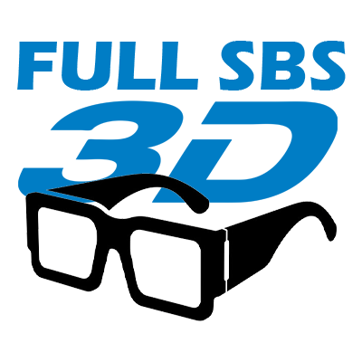

<p align="center"></p>

# 👓 Full SBS 3D Converter

**3D MV-HEVC, Top/bottom or MVC Formats to FSBS Converter**

A Windows app for converting 3D videos or movies into **Full Side-by-Side (FSBS)** `.mkv` files that 3D TVs, 3D projectors, VR headsets and media players can play:

- **3840×1080 FSBS**: 1920×1080 per eye = **1080p 3D**, for 1080p 3D TVs and projectors
- **7680×2160 FSBS**: 3840×2160 per eye = **4K 3D**, keeps full 4K per eye from UHD sources

The app is a graphical front end for **FFmpeg**, plus **FRIM** for Blu-ray 3D. It handles HDR and **Dolby Vision → SDR** tone mapping with adjustable brightness, previews a frame before you convert, and keeps your audio, subtitles and chapters.

---

## Features

- **Input formats**
  - **MV-HEVC 3D**: Apple spatial video, Apple Vision Pro, streaming 3D movies, including **Dolby Vision Profile 20**
  - **H.264 MVC**: Blu-ray 3D, e.g. MakeMKV 3D rips (decoded with FRIM)
  - **Half / Full Side-by-Side** and **Half / Full Top-Bottom (Over-Under)**
  - The input layout is auto-detected, and you can override it per file
- **Output**: FSBS `.mkv` tagged as 3D (`stereo_mode = left_right`), so players switch to 3D automatically
- **HDR / Dolby Vision → SDR**
  - Dolby Vision colour data is applied on the GPU, separately for each eye
  - Brightness is set as a **nits target**, where lower = brighter. 75 nits is recommended for 3D glasses.
  - Optional brightness boost and saturation
- **Preview frame**: renders one frame of the final output at any time position, so you can check brightness and colour before a long encode
- **Encoders**
  - NVIDIA NVENC (HEVC / AV1)
  - x265 (CPU)
  - Intel Quick Sync and AMD AMF (HEVC)
- **Audio and subtitles**: original audio is kept (e.g. Dolby Atmos / TrueHD / DTS). Subtitles and chapters are kept too.
- **Batch conversion**: drag and drop files or folders onto the window

---

## Requirements

| What | Needed for | Where to get it |
|---|---|---|
| **Windows 10 or 11** (64-bit) | everything | |
| **Python 3.10 or newer** | running the app | <https://www.python.org/downloads/> |
| **FFmpeg "full" build, version 7.1 or newer** | everything | <https://www.gyan.dev/ffmpeg/builds/> |
| **FRIM** (free MVC decoder) | **only** Blu-ray 3D / MVC files | <https://www.videohelp.com/software/FRIM> |
| A GPU with Vulkan support (any recent NVIDIA, AMD or Intel GPU with current drivers) | HDR / Dolby Vision → SDR | your GPU vendor's driver |

> FFmpeg and FRIM are separate projects with their own licences, so they are **not included** in this download. You download and unzip them yourself (below).

---

## Installation

### 1. Download this app
Download the latest `Full-SBS-3D-Converter-v1.0.zip` from the **Releases** page and unzip it to a simple location, for example:

```
C:\Full-SBS-3D-Converter\
```
Avoid `C:\Program Files`, because the app saves files next to itself.

### 2. Install Python
1. Go to <https://www.python.org/downloads/> and choose the **standalone installer** for the latest Python 3 version, under "Or get the standalone installer for Python 3.x.x".
2. On the first installer screen, **tick "Add python.exe to PATH"**, then click **Install Now**. The default install includes *tcl/tk*, which the app's window needs.

### 3. Download and unzip FFmpeg
1. Go to <https://www.gyan.dev/ffmpeg/builds/> and download **`ffmpeg-release-full.7z`** (or `ffmpeg-git-full.7z`).
   Use the **full** build: the "essentials" build lacks the libraries needed for HDR / Dolby Vision tone mapping.
2. Unzip it into the app's **`ffmpeg`** folder, using **7-Zip** (<https://www.7-zip.org>) or Windows 11's *right-click → Extract All*.

### 4. (Only for Blu-ray 3D MVC) Download and unzip FRIM
1. Go to <https://www.videohelp.com/software/FRIM> and download the **x64** version of FRIM.
2. Unzip it into the app's **`FRIM`** folder.

### Resulting folder layout
```
C:\Full-SBS-3D-Converter\
├── fsbs_converter.py
├── Start Full SBS 3D Converter.bat
├── Build EXE (optional).bat
├── glasses.ico
├── logo.png
├── README.md
├── ffmpeg\
│   └── ffmpeg-...-full_build\        ← (or directly: ffmpeg\bin\)
│       └── bin\
│           ├── ffmpeg.exe
│           └── ffprobe.exe
└── FRIM\                             ← only needed for Blu-ray 3D MVC
    └── x64\
        └── FRIMDecode64.exe  (+ its DLLs)
```
The app finds `ffmpeg.exe` and `FRIMDecode64.exe` automatically in these folders, as well as in your Downloads folder or `C:\ffmpeg`. If they are somewhere else, use the **Browse ffmpeg.exe…** and **Browse FRIM…** buttons once; the app remembers them.

### 5. Start the app
Double-click **`Start Full SBS 3D Converter.bat`**.
The top of the window should show the FFmpeg version in green. If you installed FRIM, it should also say *"FRIM ready"*.

*Optional:* run **`Build EXE (optional).bat`** to create a standalone `Full SBS 3D Converter.exe` with the 👓 icon. Keep the `ffmpeg` and `FRIM` folders next to it.

---

## How to use

1. **Add videos**: click **Add files…**, or drag files or a folder from File Explorer onto the window.
   Each file shows its resolution, codec (e.g. `hevc DV20`) and the **detected input** layout.
   If the detection is wrong, select the file, choose the correct layout under **Set input for selected file(s)** and click **Apply**.
2. **Choose the output size**:
   - **3840×1080**: best for 1080p 3D TVs and projectors, and for 1080p sources such as Blu-ray 3D. Much smaller files.
   - **7680×2160**: for true 4K-per-eye sources, e.g. 3D MV-HEVC streaming movies.
   - You can tick both.
3. **Choose the encoder**: with an NVIDIA GPU, use **H.265 / HEVC (NVIDIA NVENC)** with preset **p6 (excellent, archival)**. It is many times faster than the CPU encoders.
   **CQ/CRF**: lower = better quality and larger file. **19–21** is a good range; 16 is very high quality.
4. **HDR / Dolby Vision sources**: leave **HDR handling = Auto** and **Method = Nits target**. Then pick a brightness:
   - **75 nits**: bright, recommended for 3D glasses
   - **50 nits**: brighter still
   - **100 nits**: standard
   - **Curve**: *mobius* keeps the most brightness and is the default.
5. **Preview**: type a time (e.g. `01:10:00`) and click **Preview frame**. You will see the left and right eye exactly as the output will look. Check a bright and a dark scene, then adjust brightness or saturation if needed.
6. Click **CONVERT!**. The progress bars show speed and ETA. Output is saved next to the source, or in the **Save to** folder, as `<name>_FSBS_3840x1080.mkv` / `<name>_FSBS_7680x2160.mkv`.

### Settings reference

| Setting | What it does |
|---|---|
| **Fit** | *Fit with black bars* keeps the original shape (recommended). *Stretch* fills the frame and distorts it. *Crop* fills the frame and trims the edges. |
| **Swap eyes** | For right-eye-first sources, or if the 3D depth looks inverted. |
| **Bit depth** | *Auto* = 8-bit SDR (most compatible). 10-bit reduces banding if your player supports it. |
| **Audio** | *Copy original* keeps the original audio tracks. Anything MKV can't hold is converted to AAC. |
| **Crop top & bottom of each eye** | Extra trimming per eye. Any crop stored in the file itself (e.g. a 3840×2076 clean aperture) is applied automatically, so leave this at 0. |
| **Upscaling** | When the output is larger than the source: Lanczos (CPU), or Spline36 (GPU, libplacebo) for HDR/DV. |
| **GPU (Vulkan)** | *auto* picks the NVIDIA card if present (important on PCs with integrated graphics). You can also type part of the GPU name. |
| **Show ffmpeg command** | Shows the exact command that will run. |

### Blu-ray 3D (MVC) notes
- When ripping with **MakeMKV**, tick the **"Mpeg4 MVC"** track under the video track. It is **off by default**, and without it the MKV only contains the left eye.
  Tip: in MakeMKV *Preferences → Advanced → Default selection rule*, add `+sel:mvcvideo` so it is always selected.
- Conversion copies the 3D video stream to a **temporary file next to the output** (30–45 GB for a typical disc; deleted afterwards). FRIM then decodes both eyes, and FFmpeg encodes them with the audio and subtitles from the original MKV.
- If your FRIM version needs different options, edit **FRIM arguments**. **Reset** restores the default: `-i:mvc {in} -sw -sbs -o {out}`.

### Temporary files

| What | Where | Cleaned up |
|---|---|---|
| MVC temp stream `<name>.mvc_temp.h264` (30–45 GB) | output folder | Automatically after success, failure or cancel. It's only left behind if the app or PC crashes mid-conversion; then delete it by hand. |
| MVC preview clips | `%TEMP%\fsbs_mvc_…` | Right after the preview is shown |
| Preview images `fsbs_preview_….png` | `%TEMP%` | When the app is closed |
| Partial output of a cancelled or failed conversion | output folder | Automatically |
| Settings `.fsbs_converter.json` | `C:\Users\<you>\` | Kept, so your settings are remembered |

MV-HEVC, SBS and Top-Bottom conversions use no temp files: FFmpeg writes straight to the output file.

---

## Troubleshooting

| Problem | Fix |
|---|---|
| "Python was not found" | Reinstall Python and tick **Add python.exe to PATH**. |
| FFmpeg line is red / not found | Unzip the FFmpeg **full** build into the `ffmpeg` folder, or click **Browse ffmpeg.exe…** and pick `bin\ffmpeg.exe`. |
| Vulkan / libplacebo error in preview | Update your GPU driver. On PCs with two GPUs, type part of your GPU name (e.g. `RTX 5080`) in **GPU (Vulkan)**. |
| Dolby Vision colours look green or purple | Use **Method = Nits target** or **Adaptive** (both apply the Dolby Vision data), not *CPU only*. |
| Picture too dark | Choose a lower nits value (75 → 50) or set **SDR brightness boost**. |
| MVC: both eyes look identical | The MKV was ripped without the **Mpeg4 MVC** track. Re-rip with it ticked. |
| MVC: "FRIM not set" | Unzip FRIM into the `FRIM` folder, or click **Browse FRIM…** and pick `FRIMDecode64.exe`. |
| Anything else | Copy the last lines from the **Log** box when reporting an issue. |

---

## Command line (optional)
The same engine can be used without the window:
```
python fsbs_converter.py --cli "movie.mp4" --size 7680 --encoder hevc_nvenc --preset p6 --quality 20 --nits 75
python fsbs_converter.py --cli "movie.mp4" --preview 01:10:00
python fsbs_converter.py --cli --help
```

---

## Credits

**By ht2tweak and Claude AI**, version 1.0.

This app uses, but does not include:
- **FFmpeg**: <https://ffmpeg.org> (LGPL/GPL); Windows builds by Gyan Doshi, <https://www.gyan.dev/ffmpeg/builds/>
- **libplacebo**, used through FFmpeg for GPU tone mapping and Dolby Vision processing
- **FRIM** by videofan3d, a freeware MVC decoder based on the Intel Media SDK

The 👓 app icon is the "eyeglasses" emoji from **Noto Emoji** by Google, licensed under the Apache License 2.0.
